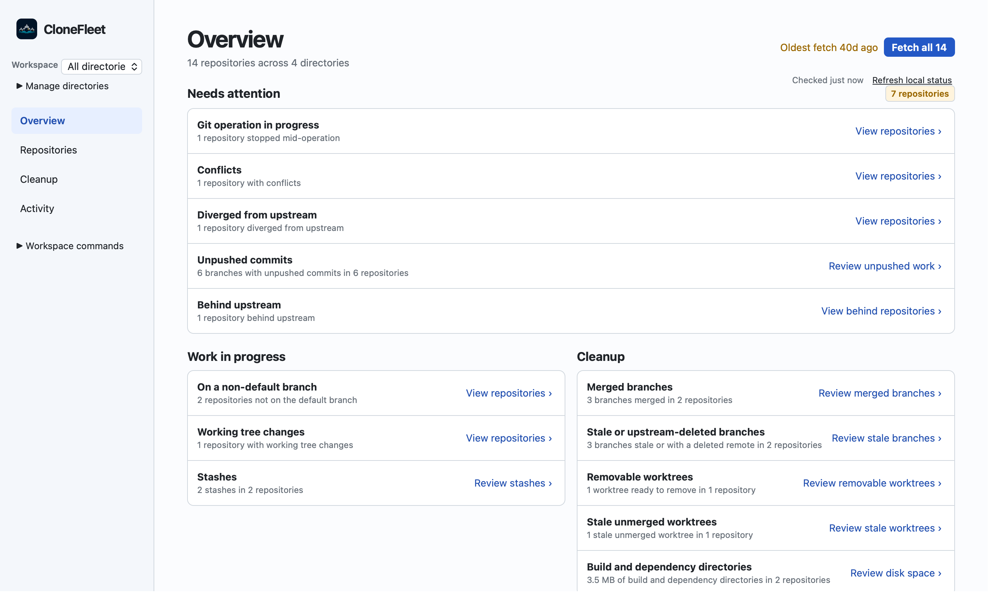
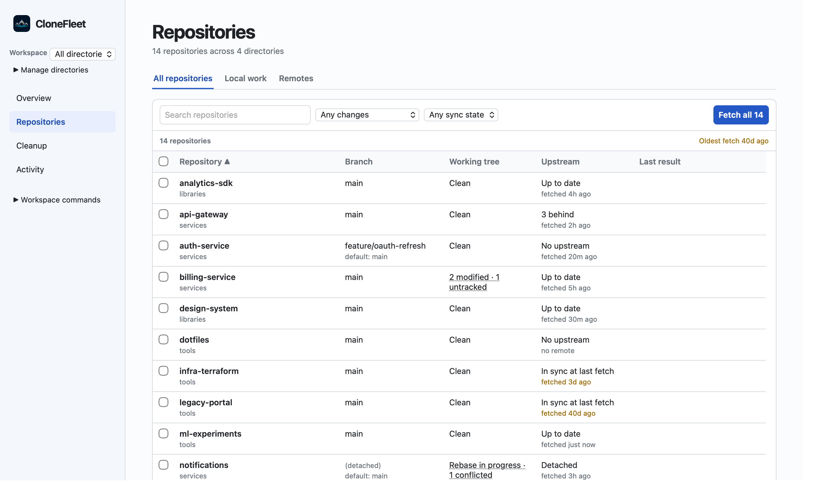
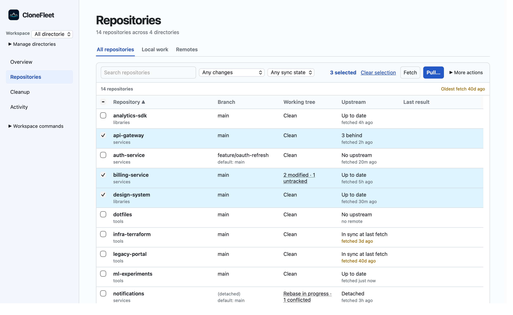
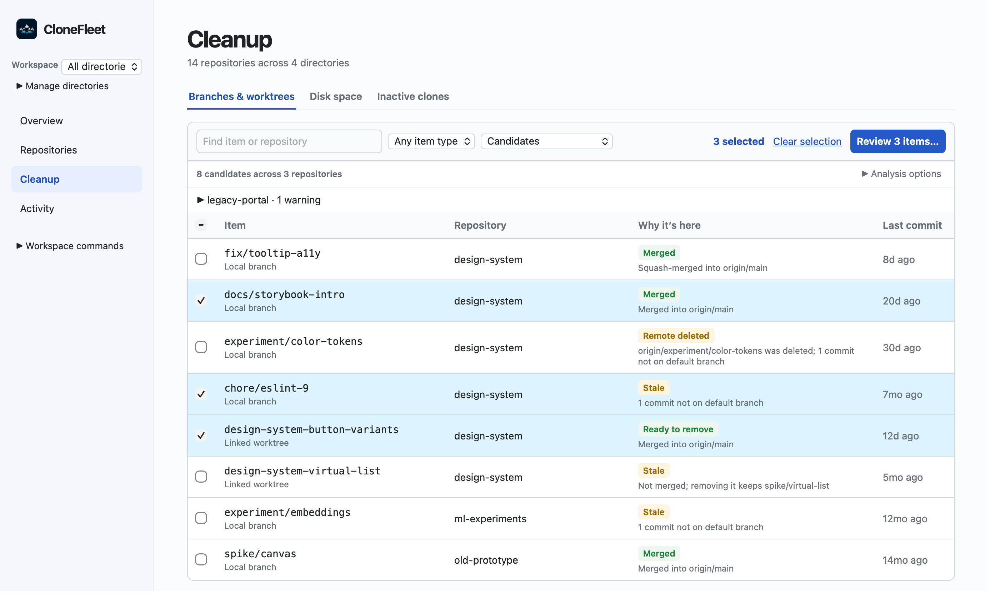
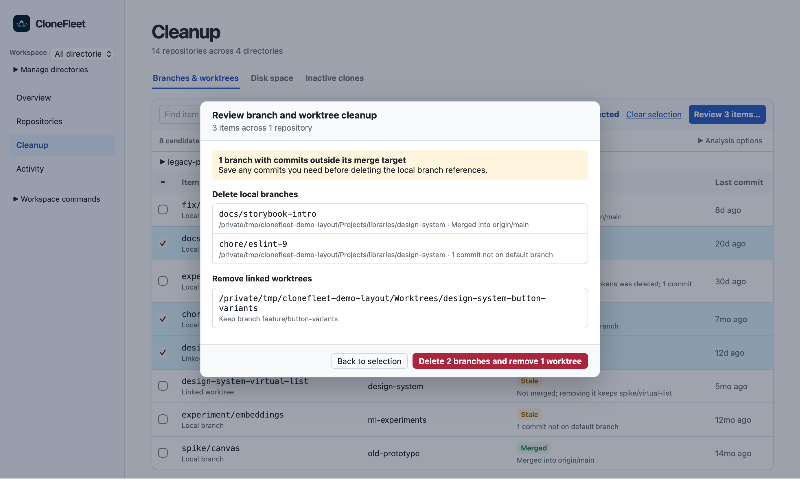
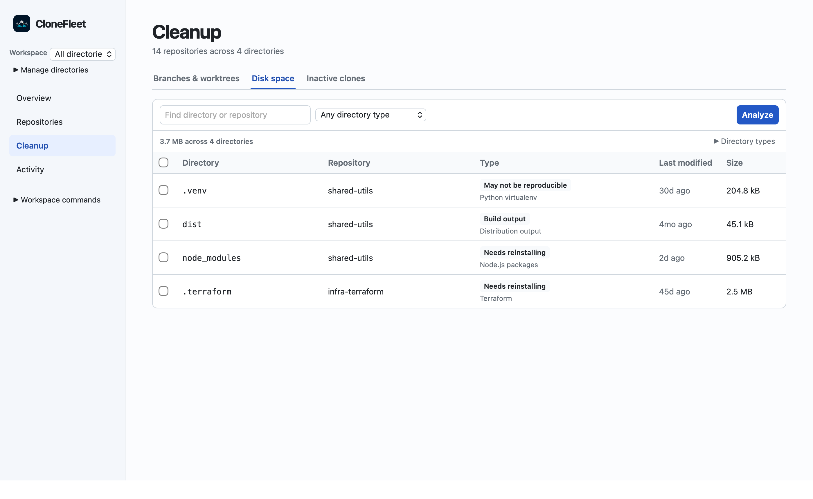
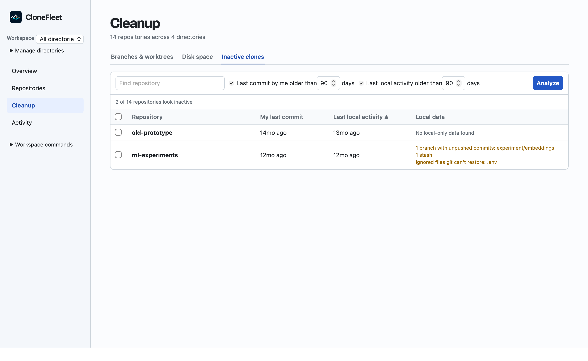
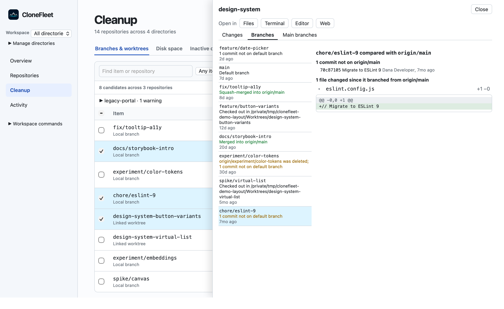
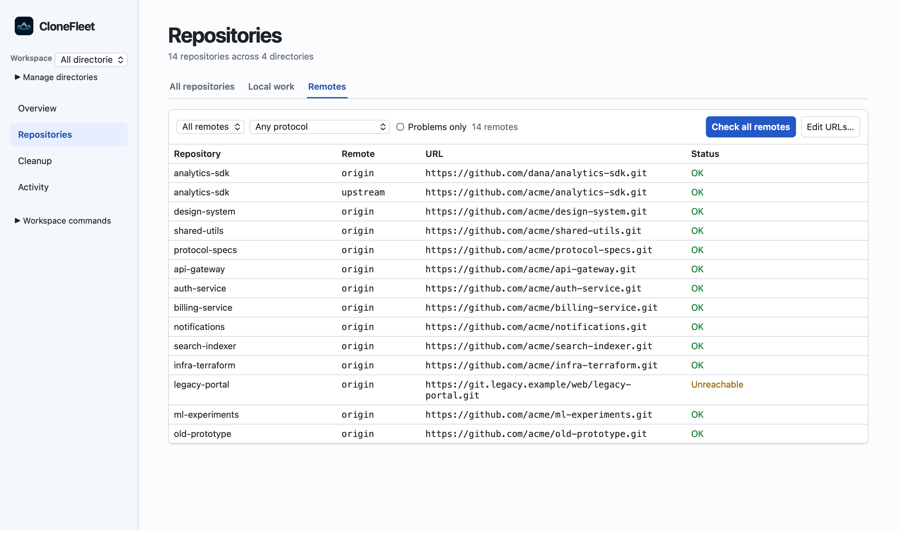

# CloneFleet


Your fleet of Git clones, under one command. A cross-platform desktop app to keep your repositories in sync, clean up branches and worktrees, and tackle routine maintenance across your fleet at once.



## Features

- **Overview dashboard** as the home screen: repositories grouped by what needs doing (stopped mid-operation, diverged, unpushed commits, behind upstream, not on the default branch, uncommitted changes, stashes, merged or stale branches, removable worktrees), with links to filtered repository and cleanup views. A background check of branches and unpushed work runs when directories load and after actions; fetching stays manual.
- **Open directories of repositories**, like a code editor's workspace. Use the **Workspace** dropdown to show all repositories or focus on one directory. **Add directory** adds to the current workspace, and **Replace open directories** opens a new workspace and remembers the old set under **Open recent**. Use **Rescan directories** to find new repositories and **Manage open directories** to close directories or restore hidden repositories. **Close all directories** leaves the workspace empty and keeps the previous set under **Open recent** when recent history is enabled. Directories are scanned up to four levels deep; linked worktrees, submodules, hidden directories, and common build/dependency directories are skipped.
- **Repositories** brings together the repository table, local work, and remotes. Search and filter the table, then select repositories to see their actions in the same toolbar.
- **Checkout the default branch.** Repositories with uncommitted changes to tracked files are skipped and reported, with per-repository options to stash (never unstashed automatically) or commit those changes.
- **Repository details panel** with tabs for **Changes** (changed files with per-file diffs), **Branches** (each branch's commits not on the base and its diff since it branched), and **Main branches** (per-repository primary branch plus extra protected main branches such as `dev` or `2.x`, which also count as merge targets).
- **Bulk run summary** after every bulk action, with counts per outcome that filter the table, and a fetch-freshness indicator per repository.
- **Open in** the file manager, a terminal, an editor, or the repository's web page from the details panel. Terminal and editor are any app you choose (with an optional arguments template); the terminal falls back to the platform default. Web addresses come from the remote URL, with optional per-host mappings for SSH aliases and self-hosted forges served from a different address.
- **Remotes page**: check every remote on demand, update remotes that moved (HTTP redirects after renames), and change URLs in bulk with find and replace or HTTPS/SSH conversion, previewed before applying.
- **Activity log** of every git command run to change a repository, searchable, filterable to failures, and exportable.
- **Clear failure reasons**: authentication, unknown host keys, missing remotes, and network errors are recognized and explained; network commands time out after two minutes, and queued repositories in a bulk run can be cancelled.
- **Sortable repository list** by name, branch, changes, sync state, or last result.
- **Settings** for reopening the last directories at launch, remembering recent directories, the git executable (detected automatically, including Homebrew locations that macOS GUI apps don't see on `PATH`, or chosen explicitly) and the theme (system, light, or dark).
- **Fetch** every remote with `--prune` without touching working trees.
- **Pull** with `--ff-only`, regardless of `pull.rebase` or autostash settings.
- **Check the default branch**: refreshes `origin/HEAD` (`git remote set-head --auto`), detects when the remote renamed its default branch (for example `master` to `main`), and offers to rename the local branch and point it at the new upstream.
- **Rebase forks** onto `upstream/<default>`:
  - Only runs on a clean default branch, and aborts on conflicts so nothing changes.
  - Afterwards it offers to push to `origin`. Force pushes are confirmed and use `--force-with-lease` pinned to the commit seen during the rebase.
- **Cleanup** combines **Branches & worktrees**, **Disk space**, and **Inactive clones**. Each view previews the exact selection before applying changes.
- **Branch cleanup:**
  - Finds merged branches using three kinds of evidence: ancestry (merge commits and fast-forwards), patch equivalence (rebase merges), and squash detection.
  - Flags branches whose remote branch was deleted, and branches with no commits newer than a configurable threshold.
  - Shows candidates in a table, with an optional tree grouped by repository and branch prefix for folder-level selection.
  - Compares against `upstream/<default>` when an `upstream` remote exists, so fork branches merged upstream are recognized.
- **Unpushed work and stashes**: per repository, lists branches with commits that exist on no remote (noting ones whose changes were already merged), uncommitted changes in any worktree, and stashes, which can be dropped after confirmation.
- **Build and dependency cleanup** frees disk space by deleting regenerable directories inside repositories and their linked worktrees: build output (Maven and Cargo `target`, `dist`, `.next`, `__pycache__`, .NET `bin`/`obj`, and similar), directories that need reinstalling (`node_modules`, Gradle `build` and `.gradle`, `.tox`, `.terraform`, `vendor`), and Python virtualenvs. Each kind is recognized by its name and its project file (for example `target` next to `pom.xml`). Sizes leave out hard-linked files, such as pnpm's, because deleting them frees nothing. Filter candidates by type, then select the directories to review. The review defaults to moving them to the Trash, with an explicit option to delete permanently.
- **Worktree cleanup** works like branch cleanup: select linked worktrees to remove while keeping their branches. Removing a missing worktree clears its Git record.
- **Inactive clones** finds clones you may no longer need, by the date of your last commit (matching each repository's `user.email`, `.mailmap` aliases, and extra identities from Settings) and of your last local activity (the newest HEAD reflog entry in any worktree, not counting CloneFleet's own pulls and switches). Either filter can be turned off, and clones you've never committed to show **Never**. Each clone lists what would be lost with it (unpushed branches and detached HEAD commits, stashes, uncommitted changes, ignored files that aren't build output, linked worktrees outside it), and selected clones can be moved to the Trash.

## Screenshots

|                                                                                                |                                                                                                           |
| ---------------------------------------------------------------------------------------------- | --------------------------------------------------------------------------------------------------------- |
|                |  |
| **Repositories** gives you search, filters, and a scoped fetch.                                | **Selection** adds actions to the same toolbar.                                                           |
|  |       |
| **Branches & worktrees** shows why each item is a candidate.                                   | **Review** lists the exact targets and flags unmerged work.                                               |
|            |                       |
| **Disk space** shows build output, dependencies, and virtual environments.                     | **Inactive clones** shows last activity and local data.                                                   |
|             |                            |
| **Branch details** shows the commits and changes before cleanup.                               | **Remotes** checks URLs and can preview bulk edits.                                                       |

See the [Disk space review](docs/screenshots/disk-cleanup-review.png) and the [Inactive clones review](docs/screenshots/inactive-review.png) for their removal options and warnings.

The screenshots use the made-up repositories from `pnpm demo`; see [docs/demo.md](docs/demo.md).

## Safety rules

- Nothing is pushed without a prompt.
- Every git command an action runs is recorded and viewable per repository.
- Repositories in the middle of a rebase, merge, cherry-pick, revert, or bisect are skipped.
- Bulk actions apply only to selected repositories that are visible under the current filters.
- The default branch, the checked-out branch, and branches checked out in other worktrees are never deleted.
- Only local branches are deleted. Deletion is re-verified at the time it runs, and deleting an unmerged branch requires explicit confirmation. Deleted branch SHAs are reported so they can be recreated.
- Worktrees with uncommitted or untracked files, locked worktrees, and the main worktree are never removed.
- Build and dependency directories are deleted only when they match a known kind, git ignores everything inside them, nothing in them is tracked, and they contain no git repository. This is re-checked when deletion runs, symlinks are never followed, and the review defaults to **Move to Trash** (empty the Trash to free their space). Permanent deletion requires choosing **Delete permanently**. Every deletion is recorded in the activity log.
- Clones are moved to the Trash, never deleted, and only from the top of a main clone. The confirmation lists everything that would be lost, and the move is skipped if the reviewed risk summary or snapshot of refs, stashes, index state, and relevant file contents has changed.

## Requirements

- git 2.28 or newer on `PATH`. The app uses your git installation, so your credential helpers, SSH configuration, and hooks apply.
- For development: Rust (stable), Node.js 22+, pnpm (`corepack enable` installs the pinned version), and the [Tauri prerequisites](https://tauri.app/start/prerequisites/) for your platform.

## Development

```sh
pnpm install
pnpm tauri dev
```

| Task             | Command                                                                           |
| ---------------- | --------------------------------------------------------------------------------- |
| Frontend tests   | `pnpm test`                                                                       |
| Rust tests       | `cargo test --manifest-path src-tauri/Cargo.toml`                                 |
| Lint             | `pnpm lint` and `cargo clippy --manifest-path src-tauri/Cargo.toml --all-targets` |
| Format           | `pnpm format` and `cargo fmt --manifest-path src-tauri/Cargo.toml`                |
| Production build | `pnpm tauri build`                                                                |

`pnpm demo` starts the app on a set of made-up repositories that show every state CloneFleet handles, without touching your real repositories or settings. See [docs/demo.md](docs/demo.md).

Rust tests create temporary repositories with local bare remotes, so they need `git` but no network access. Tauri requires the `dist` directory to exist at compile time, so run `pnpm build` once before running Rust tests or clippy on a fresh clone.

CI runs on GitHub Actions (`.github/workflows/ci.yml`): frontend lint, format, tests, and build on Linux, and Rust clippy and tests on Linux, macOS, and Windows.

### Building installers

Install dependencies with `pnpm install --frozen-lockfile`, then run the appropriate command on the OS you are building for:

| Build host | Command                              | Installer output                                                                            |
| ---------- | ------------------------------------ | ------------------------------------------------------------------------------------------- |
| Linux      | `pnpm tauri build --bundles deb,rpm` | `src-tauri/target/release/bundle/deb/*.deb` and `src-tauri/target/release/bundle/rpm/*.rpm` |
| macOS      | `pnpm tauri build --bundles dmg`     | `src-tauri/target/release/bundle/dmg/*.dmg`                                                 |
| Windows    | `pnpm tauri build --bundles nsis`    | `src-tauri/target/release/bundle/nsis/*-setup.exe`                                          |

Tauri builds the frontend and Rust application before packaging. For macOS, install the desired Rust target with `rustup target add aarch64-apple-darwin` (Apple Silicon) or `rustup target add x86_64-apple-darwin` (Intel), then add `--target <target>` to the build command. Explicit-target builds write installers under `src-tauri/target/<target>/release/bundle/`.

Linux release packages are built on Ubuntu 22.04 to avoid requiring newer glibc versions. Destination systems still need compatible GTK and WebKitGTK 4.1 libraries. See [Tauri's Linux compatibility guidance](https://v2.tauri.app/distribute/debian/#limitations).

### Releases

From a clean `main` branch, run:

```sh
pnpm release 0.1.0
```

The script accepts a stable version (`X.Y.Z`, optionally prefixed with `v`). It checks for existing local and remote tags and requires local `main` to contain the latest `origin/main` commit. It updates `package.json`, `src-tauri/tauri.conf.json`, `src-tauri/Cargo.toml`, and the CloneFleet package in `src-tauri/Cargo.lock`, commits any version changes, creates an annotated `v<version>` tag, and pushes the commit and tag atomically to `origin`. Versions cannot go backwards. If the files already have the requested version, it tags the current commit without creating a redundant commit.

Commit the release script before using it. If the push fails, the local commit and tag remain available, and the script prints a command to retry the push.

Pushing a `v*` tag runs [CI](.github/workflows/ci.yml), then the [release workflow](.github/workflows/release.yml) builds Linux x86_64 `.deb` and `.rpm` packages, Apple Silicon and Intel `.dmg` files, and a Windows x86_64 NSIS installer. Installers are uploaded to a draft GitHub release for review before publication. The macOS jobs mount each DMG and verify the bundled app's signature. Review the workflow results, installers, and release notes before publishing the draft.

### Installing builds without a verified publisher

macOS builds use an [ad hoc code signature](https://v2.tauri.app/distribute/sign/macos/#ad-hoc-signing), without Apple Developer ID signing or notarization. Windows builds are unsigned.

- **macOS:** Download the `aarch64` DMG for Apple Silicon or the `x64` DMG for Intel, then drag CloneFleet into Applications. Try opening it, then use **System Settings → Privacy & Security → Open Anyway** and confirm. See [Apple's instructions](https://support.apple.com/en-us/102445).
- **Windows:** If SmartScreen prompts, choose **More info → Run anyway**.

If macOS reports that CloneFleet is damaged, first confirm the download came from this repository's GitHub release. After copying it to Applications, you can remove its download quarantine attribute:

```sh
xattr -dr com.apple.quarantine /Applications/CloneFleet.app
```

This bypasses the download quarantine check; it does not verify the publisher or repair a broken signature. If opening still fails, collect signature diagnostics with `codesign --verify --deep --strict --verbose=2 /Applications/CloneFleet.app`.

### App icon

[`assets/clonefleet.svg`](assets/clonefleet.svg) is the authoritative source for the logo and app icon. Edit this vector artwork, then regenerate the platform icons in `src-tauri/icons`:

```sh
pnpm icons
```

Commit the SVG and regenerated icons together.

## License

[MIT](LICENSE)
